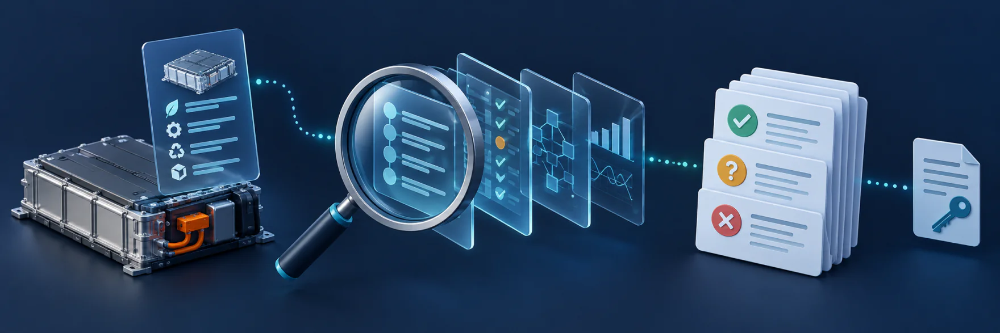
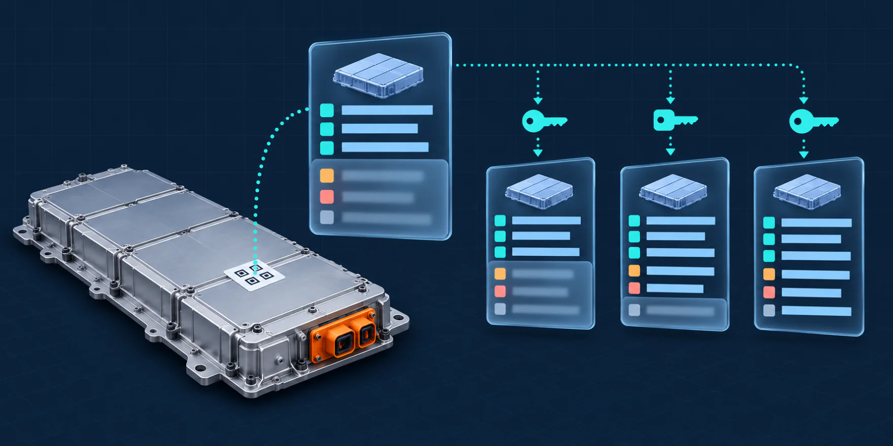
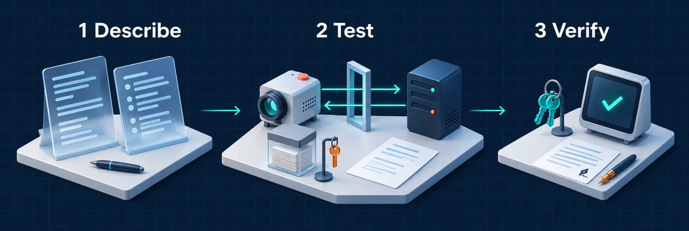
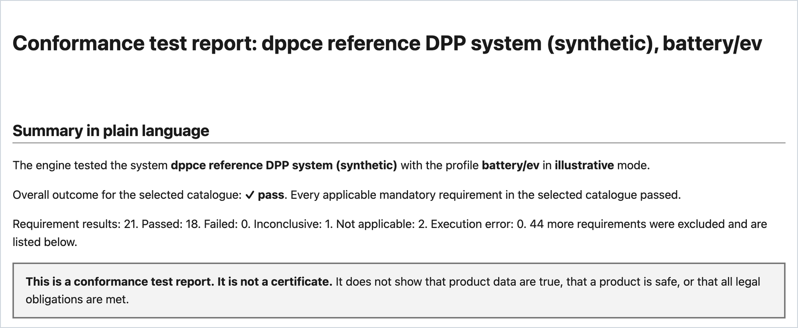
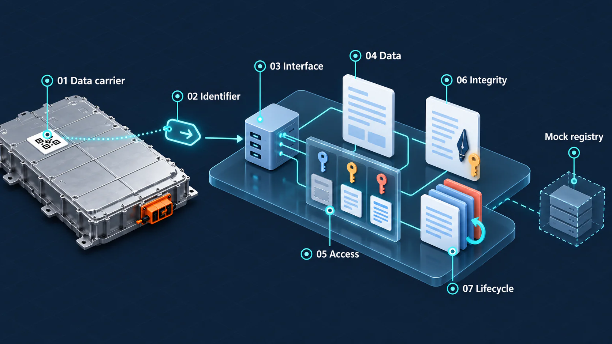
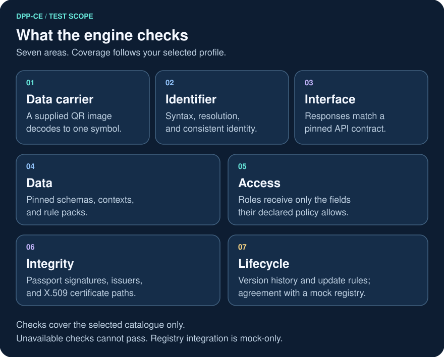
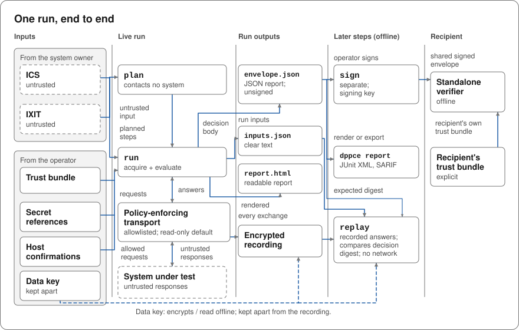
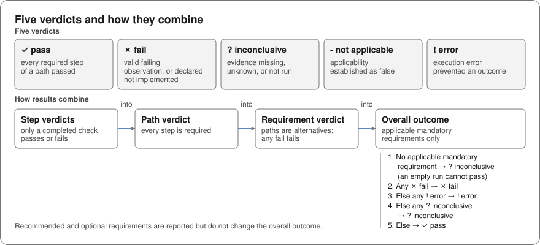
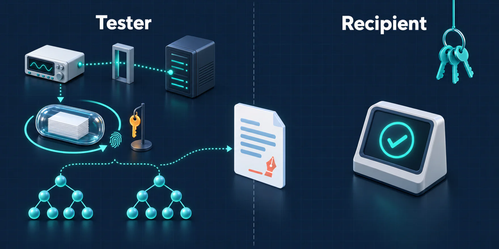
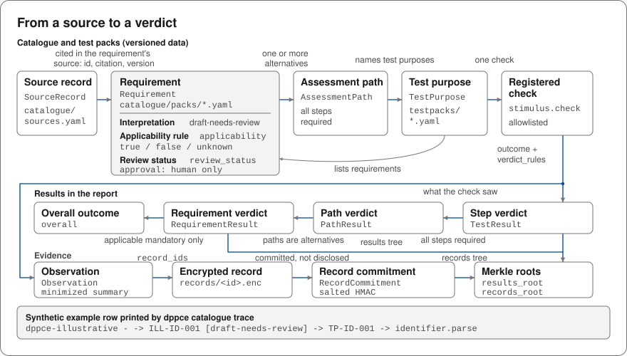

# DPP Conformance Engine (DPP-CE)

<a href="docs/images/dppce-overview.webp"></a>

**Test a Digital Product Passport system. Find gaps. Share evidence that others can verify.**

[](https://github.com/hadijannat/dpp-conformance-engine/actions/workflows/ci.yml?query=branch%3Amain)
[](https://github.com/hadijannat/dpp-conformance-engine/actions/workflows/codeql.yml)
[](https://github.com/hadijannat/dpp-conformance-engine/releases)
[](pyproject.toml)
[](LICENSES/Apache-2.0.txt)
[](LICENSES/CC-BY-4.0.txt)

<sub>**Audience:** people new to Digital Product Passports, system owners, developers, laboratories, authorities, and report recipients.<br>
**Purpose:** understand the engine, try a local test, and verify its report.<br>
**Prerequisites:** none to read. The demo needs Git, Python 3.12 or later, and [uv](https://docs.astral.sh/uv/).</sub>

DPP-CE is an open-source, vendor-neutral command line tool.
A Digital Product Passport (DPP) is a digital record about a product. A data carrier on the product, such as a QR code, leads to it.
DPP-CE tests the software system that serves a passport, not the product. It checks that system against versioned requirements and writes a **conformance test report**.

*The cover is an illustration. DPP-CE tests software, not the battery. The real report appears in the [quick start](#4-read-the-report).*

> [!WARNING]
> **Release candidate 0.1.0rc1. Not for production use.**
> Shipped rules are synthetic examples or unreviewed drafts. Validation uses synthetic systems.
> Reports are not certificates. They make no statement of legal compliance or product safety, and they do not show that passport data are true.
> See [limitations and readiness](#limitations-and-readiness).

**Jump to:** [What a DPP is](#what-is-a-digital-product-passport) · [How it works](#how-it-works) · [Quick start](#quick-start) · [What it checks](#what-the-engine-checks) · [Results](#what-a-result-means) · [Evidence](#evidence-that-others-can-verify) · [Your own system](#test-your-own-system) · [Limitations](#limitations-and-readiness) · [All guides](docs/index.md)

## What is a Digital Product Passport?

<a href="docs/images/dpp-explained.webp"></a>

*Illustration, not test evidence. Each key stands for a reader role. Blurred rows are fields that the role cannot see, and the colors are not verdicts. Select an image to open it at full size.*

A Digital Product Passport gives access to data about a product, a batch, or a product model. It can hold, for example, information about materials, repair, or recycling.
A data carrier on the product, such as a QR code, leads to it.
Different readers can see different parts of the same passport. An access policy decides which part each reader role gets, for example the public or an authority.

From 2027-02-18, the EU Batteries Regulation requires a passport for light means of transport batteries, industrial batteries above 2 kWh, and electric vehicle batteries.
Under the Ecodesign for Sustainable Products Regulation (ESPR), another product group gets a passport duty only through a delegated act.
**DPP-CE tests the software system that serves a passport. It does not test the product.**
[Why this exists](#why-this-exists) gives the legal context.

## How it works

<a href="docs/images/three-steps.webp"></a>

*Illustration, not test evidence. The check mark means that the report is intact and signed by a trusted issuer. It does not mean that the system passed.*

1. **Describe** the system. The owner declares it in an ICS. The IXIT lists the endpoints and inputs for the tester.
2. **Test** it. The engine sends the planned requests through one policy-enforcing transport. It encrypts its records, keeps the data key apart, and writes a conformance test report.
3. **Verify** the report. The issuer signs it separately. A recipient checks the signed report offline with its own trust bundle.

[How a run works](#how-a-run-works) gives each step in detail.

## Who it is for

| You are | Start here |
| --- | --- |
| New to DPPs | [What a DPP is](#what-is-a-digital-product-passport), the [scope and legal mapping](docs/explanation/scope-and-legal-mapping.md), and the [glossary](docs/reference/glossary.md) |
| A system owner or a vendor | [Quick start](#quick-start), then [test your own system](#test-your-own-system) |
| A developer or an integrator | [Command line](docs/reference/cli.md), [CI formats](docs/how-to/verify-a-report.md#use-a-report-in-ci), and [schemas](docs/reference/schemas.md) |
| A testing laboratory or an assessor | [Operate in a laboratory](docs/how-to/operate-in-a-laboratory.md), [architecture](docs/explanation/architecture.md), and [method validation](docs/how-to/run-the-method-validation.md) |
| An authority or a report recipient | [If you received a signed report](#if-you-received-a-signed-report), then [verify a report](docs/how-to/verify-a-report.md) |
| A decision maker | [What a result means](#what-a-result-means), then [readiness](docs/readiness.md) |
| A researcher or a contributor | [Cite](#cite), [source audit](docs/research/source-audit.md), and [contribute](#contribute) |

## Quick start

This demo tests a local reference system with synthetic data. The run contacts only this local system.
The fixture keys and tokens are published test values, named `TEST-ONLY-...`.
No terminal at hand? Skip to [what the engine checks](#what-the-engine-checks).

### 1. Install from source

You need Git, Python 3.12 or later, and [uv](https://docs.astral.sh/uv/).
The demo uses the fixtures in the source checkout. The checkout also includes [unreleased changes](CHANGELOG.md#unreleased).
For the published release, use the [release installation guide](docs/how-to/install-and-verify-a-release.md).

```bash
git clone https://github.com/hadijannat/dpp-conformance-engine.git
cd dpp-conformance-engine
uv sync --all-extras
```

### 2. Start the reference system

Run every command from the repository root. Keep this terminal open, and keep the port 8765. The fixture IXIT names it.

```bash
uv run python -m dppce.infrastructure.reference_server --port 8765
```

### 3. Run the battery example

Open a second terminal in the same directory:

```bash
uv run dppce run \
  --mode illustrative \
  --profile battery/ev \
  --ics fixtures/reference/ev.ics.yaml \
  --ixit fixtures/reference/ev.ixit.yaml \
  --trust fixtures/reference/trust/TEST-ONLY-trust-bundle.json \
  --secrets fixtures/reference/secrets \
  --allow-private-host http://127.0.0.1:8765 \
  --role-secret legitimate_interest=file:TEST-ONLY-legitimate_interest.token \
  --role-secret authority=file:TEST-ONLY-authority.token \
  --issuer-name "synthetic test laboratory" --issuer-id urn:example:test-lab \
  --at 2026-10-13T12:00:00Z \
  --keys ./runs/keys --create-data-key --out ./runs/ev-1
```

The command exits with code `0` and prints three lines.
Each live run records new times and new salted commitments, so its digest changes. A replay of the same recording gives the same digest.

```text
overall pass: Every applicable mandatory requirement in the selected catalogue passed.
digest sha256:<64 hexadecimal characters>
run runs/ev-1
```

This `pass` covers the synthetic rules of the demo only. It makes no statement about a law.

<details>
<summary>What the options do</summary>

- `--mode illustrative` assesses the synthetic rules only. The result makes no statement about a law.
- `--at` fixes the evaluation time. The freshness rule of the fixture depends on it.
- `--allow-private-host` and `--role-secret` are confirmations from the operator. Without them, the engine refuses the host and the secrets.
- `--secrets` names the directory that holds the token files.
- `legitimate_interest` and `authority` are role names of the synthetic access policy. They do not encode the access rights of the Regulation.
- The fixture IXIT names a signed `TEST-ONLY` authorization for the local origin. Role credentials need such an authorization.
- `--issuer-id` must match the issuer of the signing key in the trust bundle.

</details>

<details>
<summary>If the run gives <code>inconclusive</code> and exit code 5</summary>

You did not start the reference system, or you did not install with `--all-extras`.
Fix the cause, keep the failed run, and choose a new directory such as `--out ./runs/ev-2`.
Use that directory in subsequent commands. The existing data key can be reused.

</details>

### 4. Read the report

Open `runs/ev-1/report.html` in a browser. Start with the summary, then read the results and the exclusions.

[](docs/images/report-summary.png)

The image shows the top of `report.html` from this demo, captured on 2026-10-29. The data are synthetic, and the mode is `illustrative`.
The summary names the system, the profile, and the mode. It gives the overall outcome and the requirement counts.
The one `inconclusive` result is a recommended manual step, so it does not change the overall outcome.
The exclusions list the draft and placeholder requirements, and their test steps, that `illustrative` mode leaves out. Counts change when the catalogue changes.

<details>
<summary>What the run writes</summary>

| Output | Contents |
| --- | --- |
| `runs/ev-1/report.html` | Readable report: verdicts, coverage, reasons, exclusions, and next steps |
| `runs/ev-1/envelope.json` | JSON report, unsigned until you sign it |
| `runs/ev-1/inputs.json` | Run inputs and their digests, in clear text |
| `runs/ev-1/recording/` | Encrypted records and a clear-text index, for replay |
| `runs/ev-1/envelope.signed.json` | Signed JSON report, after the optional signing step |
| `runs/keys/` | Local data key that decrypts the recording |

A run never overwrites an earlier run. For another run, choose a directory that does not exist yet.
Keep the data key to replay a recording.

</details>

The [first-run tutorial](docs/tutorials/first-run.md#8-see-a-failure) shows how to introduce a fault and read the failure.

<details>
<summary><strong>Continue: replay, sign, and verify</strong></summary>

Replay the recording five times. Each replay must reproduce the decision digest of the run. You can stop the reference system first:

```bash
uv run dppce replay --run ./runs/ev-1 --keys ./runs/keys --times 5
```

The output includes `5 replays: match`, and the exit code is `0`.

Sign the JSON report with the published test signing key:

```bash
uv run dppce sign --envelope ./runs/ev-1/envelope.json \
  --key fixtures/reference/trust/TEST-ONLY-report-signing.key.pem \
  --kid TEST-ONLY-report-key-1 --issuer urn:example:test-lab \
  --allow-unencrypted-key --out ./runs/ev-1/envelope.signed.json
```

The fixture key is not encrypted, so the demo needs `--allow-unencrypted-key`.
For your own reports, `dppce keys generate` writes a signing key that a passphrase encrypts.

Verify the signed report with the standalone verifier:

```bash
uv run python -m dppce.verifier ./runs/ev-1/envelope.signed.json \
  --trust fixtures/reference/trust/TEST-ONLY-trust-bundle.json --at 2026-10-14T00:00:00Z
```

The verifier prints one outcome for each verification dimension, and `"complete": true`.
`complete` is `true` only if every mandatory dimension passed.
The demo signature names no status entry, states no validity period, and has no timestamp.
The demo trust bundle requires no status entry and no timestamp. So `status`, `validity`, and `timestamp` show `not_checked`.
A real recipient uses its own trust bundle and gets the issuer key through its own channel, never from the report.
For your own reports, use the time at which you rely on the report.
[Verify a report](docs/how-to/verify-a-report.md) explains each dimension.

</details>

## What the engine checks

<a href="docs/images/dpp-anatomy.webp"></a>

*Illustration, not test evidence. The numbers label parts, not steps. The mock registry stands in for a real registry. The list below names the same seven parts.*

The engine observes seven parts of a DPP system:

1. **Data carrier:** a supplied QR image decodes to one symbol. The engine reads an image file. It does not scan the product.
2. **Identifier:** the identifier has its declared syntax, resolves to the passport, and is the same in each place.
3. **Interface:** a response matches the API contract that the system owner pins.
4. **Data:** a document matches a pinned schema, a context allowlist, and a rule pack.
5. **Access:** each role gets no field that the declared access policy withholds.
6. **Integrity:** a signature is valid, its issuer is trusted, and its X.509 certificate is valid.
7. **Lifecycle:** the version history follows the declared update rule. A record in a mock (stand-in) registry agrees with the passport.

The checks test form, rules, and consistency. They do not show that the data are true.
The [scope page](docs/explanation/scope-and-legal-mapping.md#1-what-the-engine-tests) gives the same list. Checks are deterministic code.

<details>
<summary>Show the seven areas as a card diagram</summary>

<a href="docs/images/test-areas.svg">
  <picture>
    <source media="(max-width: 600px)" srcset="docs/images/test-areas-mobile.svg">
    
  </picture>
</a>

The cards repeat the list above.

</details>

### Key features

- **Traceable:** each interpreted requirement links its source provision to test purposes and executable checks. A placeholder links to its source only.
- **Deterministic:** versioned data and deterministic code select the checks and calculate the verdicts. No language model takes part at run time.
- **Replayable:** keep encrypted recordings, replay them offline, and compare the steps that changed between two runs.
- **Ready for CI:** reports come as HTML and JSON. JUnit XML and SARIF exports support continuous integration (CI) tools.
- **Independently verifiable:** a recipient verifies a signed report with the standalone verifier and its own trust bundle.

Checking a passport signature and verifying a signed test report are separate operations.

## How a run works

Two input files describe the system and the test:

- **ICS (Implementation Conformance Statement):** what the system owner declares about the system.
- **IXIT (Implementation eXtra Information for Testing):** endpoints, sample files, and other inputs that the tester needs.

The engine treats both files as untrusted input.
The **operator** is the person who runs the engine.
The operator supplies the **trust bundle**, the explicit list of keys and anchors that the operator trusts.
The operator also confirms each private host and each secret reference.
The **issuer** is the party that signs the report, for example a testing laboratory.

<a href="docs/images/run-lifecycle.svg">
  <picture>
    <source media="(max-width: 600px)" srcset="docs/images/run-lifecycle-mobile.svg">
    
  </picture>
</a>

The steps below follow the diagram. Replay, export, and signing each read the run outputs independently.

1. **Plan:** select requirements and test steps from the profile, the packs, the ICS, and the IXIT. It sends no request.
2. **Run:** send the planned requests through one policy-enforcing transport. Only this step contacts the system under test.
3. **Record:** the run writes an encrypted recording, the run inputs, the JSON report, and the HTML report.
4. **Replay:** evaluate the recording again offline. Compare the decision digest, the SHA-256 digest of the decision body.
5. **Export:** render the JSON report as HTML, or export it as JUnit XML or SARIF.
6. **Sign and verify:** sign the report separately. A recipient checks it with the standalone verifier and its own trust bundle.

`dppce run` does steps 1 to 3 in one command. `dppce plan` does step 1 alone.
Replay does not test the system again. Verification says nothing new about the system under test.

## What a result means

<a href="docs/images/verdicts.svg">
  <picture>
    <source media="(max-width: 600px)" srcset="docs/images/verdicts-mobile.svg">
    
  </picture>
</a>

| Verdict | Meaning |
| --- | --- |
| `pass` | At least one assessment path, a defined way to test the requirement, passed. No valid observation failed. |
| `fail` | A valid observation or a declaration contradicts a selected requirement. |
| `inconclusive` | The evidence cannot establish an outcome. For example, applicability is unknown or a step did not run. |
| `not_applicable` | The requirement does not apply to the declared system. |
| `error` | An execution error prevented an outcome, and no other path passed or failed. |

How the overall outcome works:

- It uses the applicable mandatory requirements only.
- The worst result wins, in this order: `fail`, `error`, `inconclusive`, `pass`. An empty run cannot pass.
- A requirement with unknown applicability is `inconclusive`. It stays outside the overall outcome, and the report counts it.
- Recommended and optional requirements do not change the overall outcome.
- Absent information never becomes `not_applicable`. An unavailable check never becomes `pass`.

Read the counts as well as the overall outcome. The [verdict truth table](docs/reference/verdict-truth-table.md) lists every case.

### Execution modes and claim levels

The **execution mode** decides which requirements a run can assess.
The **claim level** says what you can cite a result as.

| Mode | A run can assess | Claim level of a result |
| --- | --- | --- |
| `illustrative`, the default | Synthetic rules only | `illustrative` |
| `exploratory` | Draft interpretations, synthetic rules, and placeholders | `diagnostic`; `illustrative` for a synthetic rule; `none` for a placeholder |
| `reviewed` | Normative requirements with a human approval record only | `reviewed` |

A run lists each requirement that its mode leaves out as an exclusion, with a reason code.
No shipped requirement has the status `approved`. Only a human reviewer can approve an interpretation.
Without a signed manual result, no verdict from `eu-battery/draft` is `pass` or `fail`, in any mode.
See [how to import an approved pack](docs/how-to/import-an-approved-pack.md).

<details>
<summary>Packs: what each one holds</summary>

A **pack** is a versioned set of requirements with a scope statement.

| Pack | Content | What a result means |
| --- | --- | --- |
| `illustrative/core` | Synthetic rules for the battery reference system | `illustrative`; no normative statement |
| `family/illustrative` | Synthetic web, GS1 resolver, AAS, and credential rules | `illustrative`; no normative statement |
| `family/oauth` | One synthetic rule: each role gets only what the declared access policy allows | `illustrative`; no normative statement |
| `eu-battery/draft` | Draft interpretations of Regulation (EU) 2023/1542 that a development agent (an AI coding assistant) wrote | `diagnostic` in `exploratory` mode; excluded in `illustrative` and `reviewed` modes |
| `en-jtc24/placeholders` | Bibliographic placeholders for eight EN standards of CEN/CLC/JTC 24 "Digital Product Passport - Framework and System" | No clause assessed; optional, so the overall outcome does not change |

</details>

<details>
<summary>Exit codes</summary>

| Code | Meaning |
| --- | --- |
| `0` | The command completed. For `run` and `replay`, the overall outcome is `pass`. For `compare`, every step verdict is equal. |
| `1` | The overall outcome is `fail`. For `compare`, a step verdict changed. |
| `2` | Usage or input error. A catalogue lint error also gives this code. |
| `3` | Execution error: the overall outcome is `error`, or the engine failed. |
| `4` | Report verification failed or is incomplete, or a replay did not reproduce the recorded digest. |
| `5` | The run completed, and the overall outcome is `inconclusive`. |

A replay can reproduce a `fail` or `inconclusive` outcome. It then returns the same exit code as the run.

</details>

## Evidence that others can verify

<a href="docs/images/evidence-chain.webp"></a>

*Illustration, not test evidence. Left is the tester's side: the capsule is the encrypted recording, and its key stays apart. The two trees bind the report to its records and results. Right is the recipient's side. Only the signed report crosses. The check mark means that the report is intact, not that the system passed.*

A recipient can check a conformance test report offline, without help from the tester. The recipient decides which issuers to trust.

- Only the run contacts the system under test. It uses one controlled connection, the policy-enforcing transport.
- The run encrypts each record. The data key stays with the operator, outside the recording.
- The report does not hold the records. It holds a salted commitment, a kind of fingerprint, to each record.
- A records tree binds the commitments. A separate results tree binds the test and requirement results.
- The issuer signs the JSON report in a separate step, with `dppce sign`.
- The recipient verifies the signed report offline with the standalone verifier. Its own trust bundle supplies the issuer key, never the report.
- A replay of the recording reproduces the decision digest. Replay needs the recording and the data key.

Verification shows that the report is intact and that a trusted issuer signed it.
It does not show that the issuer observed what the report says. It says nothing new about the system under test.

### If you received a signed report

1. Get the public key of the issuer through a channel that you trust. Never take the key from the report.
2. Add the key to your own trust bundle with `dppce trust-bundle add-key`.
3. Run the standalone verifier with your trust bundle. Set `--at` to the time at which you rely on the report.
4. Read the exit code. `0` means that every mandatory dimension passed. `4` means that the verification failed or is incomplete.
5. Read the report itself: the mode, the claim level, the counts, and the exclusions. In `illustrative` mode, only synthetic rules count.
6. Treat the accreditation status as a statement of the operator. The engine does not verify it.

[Verify a report](docs/how-to/verify-a-report.md) gives the commands and explains each dimension.

<details>
<summary>Trace a requirement from its source to a verdict</summary>

<a href="docs/images/traceability.svg">
  <picture>
    <source media="(max-width: 600px)" srcset="docs/images/traceability-mobile.svg">
    
  </picture>
</a>

A requirement cites a source record. It holds its interpretation, its applicability rule, and its review status.
Its assessment paths name test purposes. Each test purpose names one registered check.
A step verdict goes into the path verdict, the requirement verdict, and the overall outcome.
Each observation names its encrypted records. The report holds a salted commitment to each record.
The results tree binds test and requirement results. A separate records tree binds commitments to recorded content.

Print the chain from source to check for each requirement in the catalogue:

```bash
uv run dppce catalogue trace
```

</details>

## Test your own system

> [!IMPORTANT]
> Get the permission of the system owner before any test, also for read-only access.
> Read [test a real system](docs/how-to/test-a-real-system.md) before you connect to one.

**Web, GS1 resolver, AAS, and credential passports.** Draft an ICS and an IXIT for a family profile:

```bash
uv run dppce init --family web --out ./my-system
```

The `--family` option accepts `web`, `gs1-resolver`, `aas`, and `credentials`.
The command writes a draft ICS and IXIT with review comments. It grants no trust, permission, or authorization.
Then follow [draft the files for your own system](docs/tutorials/test-your-own-system.md).

**Battery passports.**

1. Copy `fixtures/reference/ev.ics.yaml` and `fixtures/reference/ev.ixit.yaml`. Declare your system, as [write an ICS and an IXIT](docs/how-to/write-an-ics-and-an-ixit.md) shows.
2. Copy the data root. Write a profile that binds your own API contract and access policy, and give the copy with `--data-root`.
3. For role credentials or probes, ask the owner to sign an authorization with `dppce authorize`.
4. Run with `--mode exploratory`. No draft entry gives `pass` or `fail` until a person signs a manual result for it (`--manual-result`).

The shipped battery profiles pin a synthetic schema. [Test a real system](docs/how-to/test-a-real-system.md) shows each step.
Role credentials, TLS client authentication, and access probes need a signed authorization that names the origin.
The operator supplies the trust bundle and confirms each origin and each secret reference.

## Profiles

A **profile** selects packs, test packs, and resources for one product type or one passport technology.
A profile does not cover a law or a standard. The scope statement of each pack says what the pack covers.

<details>
<summary>All eight profiles and their packs</summary>

| Profile | For | Packs |
| --- | --- | --- |
| `battery/ev` | Electric vehicle battery passports; used in the demo | `illustrative/core`, `eu-battery/draft`, `en-jtc24/placeholders` |
| `battery/lmt` | Light means of transport battery passports | Same as `battery/ev` |
| `battery/industrial` | Industrial battery passports | Same as `battery/ev` |
| `family/web` | Web passports with HTML or JSON representations | `family/illustrative` |
| `family/gs1-resolver` | GS1 Digital Link identifiers and resolver behavior | `family/illustrative` |
| `family/aas` | Asset Administration Shell (AAS) files and API responses | `family/illustrative` |
| `family/credentials` | Signed credentials, issuer keys, and status information | `family/illustrative` |
| `family/oauth` | Passport views behind OAuth 2.0 client credentials | `family/oauth` |

The three battery profiles differ only in their product category.

</details>

Profiles combine supported checks, experimental checks, and manual steps.
Some capabilities are planned but not built (`interface_only`). A step that needs one stays `inconclusive`.
The [capability manifest](docs/reference/capabilities.md) gives the state and the limits of each capability.
Show the capabilities of your installation:

```bash
uv run dppce capabilities
```

## Why this exists

Several EU regulations set up a passport, for example:

- [Regulation (EU) 2023/1542](https://eur-lex.europa.eu/eli/reg/2023/1542/oj/eng), Article 77, requires a **battery passport** from 2027-02-18.
  It applies to batteries placed on the market or put into service from that date. The duty covers light means of transport (LMT) batteries, industrial batteries above 2 kWh, and electric vehicle batteries.
- [Regulation (EU) 2024/1781](https://eur-lex.europa.eu/eli/reg/2024/1781/oj/eng), the Ecodesign for Sustainable Products Regulation (ESPR), establishes the **digital product passport** framework. A product group gets this duty only through a delegated act.

The legal pack of this engine holds draft interpretations of the Batteries Regulation only.

Manufacturers, software vendors, and service providers now build DPP systems.
Before others rely on a system, its owner needs to know how the system behaves.
A recipient of a test result needs evidence that the recipient can check without the tester.

DPP-CE addresses both needs with versioned requirements, deterministic checks, encrypted recordings, and signed reports.
It tests the DPP system itself. It does not contact the EU DPP registry or its testing environment.
The Commission [announced the registry and the testing environment](https://single-market-economy.ec.europa.eu/news/digital-product-passport-registry-now-live-2026-07-20_en) on 2026-07-20.
A market surveillance authority decides whether a report helps its own checks. A report never replaces them.
The [scope and legal mapping](docs/explanation/scope-and-legal-mapping.md) explains how the engine relates to each regulation.

## What people expect, and where DPP-CE stands

Manufacturers need useful gap reports. Developers need repeatable checks. Recipients need to inspect the evidence behind a result.
Consumers, repairers, and recyclers need usable product information throughout a product's life.

The table synthesizes public sources checked on **2026-10-29**.
Legal duties apply to passports and to the economic operators that are responsible for them. Expectations for test tools are engineering inferences unless a source states them directly.
This is not a survey of DPP-CE users. No person has reviewed this agent-written synthesis.
In short, DPP-CE covers selected technical checks. It does not cover legal readiness, usability, or the EU registry.

| Stakeholders and expected outcome | Source | DPP-CE today |
| --- | --- | --- |
| Manufacturers and smaller businesses: clear scope and useful next steps | [CIRPASS-2 readiness findings](https://cirpass2.eu/project-results/) | Reason codes and report hints; no legal readiness score |
| Vendors and integrators: interoperable data and repeatable tests | [CIRPASS-2 validator](https://github.com/CIRPASS-2/dpp-validator), [UNTP tests](https://github.com/uncefact/tests-untp) | Pinned resources, replay, JUnit XML and SARIF; capability-specific limits |
| Laboratories and recipients: traceable checks and inspectable evidence | [BatteryPass-Ready test goals](https://thebatterypass.eu/battery-pass-ready/faq/) | Source-to-check traceability and signed reports; no approved interpretations or independent validation |
| Data owners and authorities: controlled access and trustworthy records | [Batteries Regulation, Articles 77–78](https://eur-lex.europa.eu/eli/reg/2023/1542/oj/eng) | Declared-policy and signature checks; no proof of data truth or legal access rights |
| Consumers, repairers, and recyclers: usable information that remains available | [ESPR, Articles 9–11](https://eur-lex.europa.eu/eli/reg/2024/1781/oj/eng) | Selected interface and lifecycle checks; no usability study, backup check, or availability monitoring |
| Economic operators: registry integration checks | [Commission registry announcement](https://single-market-economy.ec.europa.eu/news/digital-product-passport-registry-now-live-2026-07-20_en) | Mock registry only; no EU registry connection or submission |

The [stakeholder research and coverage assessment](docs/research/stakeholder-expectations-2026-10-29.md) separates evidence classes and explains gaps and priorities.
It includes the limits of published surveys and the distinction between legal obligations and demand for testing tools.
The [capability manifest](docs/reference/capabilities.md) states each check's implementation status.

<details>
<summary>Related tools</summary>

These projects address different needs. Each description reflects its own page, checked on 2026-10-29.
Their inclusion implies no endorsement, compatibility, or integration with DPP-CE.

- [BatteryPass-Ready](https://thebatterypass.eu/battery-pass-ready/faq/): a battery testing and learning environment, with gradual prototype access in 2026.
  Full public release is planned for Q1 2027. Its FAQ says it is not a certification system.
- [EU DPP registry](https://single-market-economy.ec.europa.eu/news/digital-product-passport-registry-now-live-2026-07-20_en): the Commission's registry, with a testing environment for economic operators.
- [CIRPASS-2 DPP validator](https://github.com/CIRPASS-2/dpp-validator): payload checks with JSON Schema or SHACL. Its scope is exploratory and non-normative.
- [UNTP tests](https://github.com/uncefact/tests-untp): test suites and a reference implementation for the UN Transparency Protocol.

</details>

## Limitations and readiness

- The method validation uses synthetic systems only. The reference system and the checks come from the same project.
- The battery profiles use a synthetic schema. No Annex XIII data point gets an automated check.
- Applicability rests on the facts that the ICS declares. The engine does not compare them with the passport.
- The report repeats the operator's declared accreditation status. The engine does not verify it.
- No interpretation has human approval. The project has no interpretation reviewer yet. See [governance](GOVERNANCE.md).
- A development agent (an AI coding assistant) wrote the draft interpretations.
- No independent human security audit and no screen-reader accessibility review exist yet.
- The [readiness record](docs/readiness.md) names the command and the commit of each recorded result. It also says which records no person has reviewed.
- The Python import surface is not a stable API yet. Use the command line and the JSON report.
- The package is not on PyPI. The [release guide](docs/how-to/install-and-verify-a-release.md) lists the release files and the container image.

## Documentation

| Your next task | Guide |
| --- | --- |
| Find any page | [Documentation index](docs/index.md) |
| Learn the terms and the inputs | [Glossary](docs/reference/glossary.md), [write an ICS and an IXIT](docs/how-to/write-an-ics-and-an-ixit.md) |
| Find commands and check limits | [Command line](docs/reference/cli.md), [capability manifest](docs/reference/capabilities.md), [reason codes](docs/reference/reason-codes.md) |
| Understand the design | [Architecture contract](docs/explanation/architecture.md), [decision records](docs/adr/README.md), [threat model](docs/explanation/threat-model.md) |
| Inspect the synthetic system | [Reference system and data formats](docs/reference/reference-system.md) |
| Check the scope and the sources | [Scope and legal mapping](docs/explanation/scope-and-legal-mapping.md), [source audit](docs/research/source-audit.md) |
| See open work | [Open questions](docs/open-questions.md), [backlog](docs/backlog.md), [task state](TASKS.md) |

<details>
<summary>Repository layout</summary>

The engine lives in [`src/dppce/`](src/dppce/).
[`catalogue/`](catalogue/), [`profiles/`](profiles/), and [`testpacks/`](testpacks/) hold requirements, configurations, and test purposes.
[`fixtures/`](fixtures/), [`tests/`](tests/), and [`validation/`](validation/) hold examples and verification material.

</details>

## Get help

- Report a bug with the **Bug report** issue template.
- Propose, question, or correct an interpretation with the **Requirement interpretation** template.
- Report a vulnerability through the private channel in [SECURITY.md](SECURITY.md). Do not open a public issue.

## Contribute

Code, documentation, test fixtures, and interpretation reviews are welcome.
Read [CONTRIBUTING.md](CONTRIBUTING.md), the [Code of Conduct](CODE_OF_CONDUCT.md), the [DCO](DCO.md), and [GOVERNANCE.md](GOVERNANCE.md).

```bash
uv sync --all-extras
uv run pre-commit install
uv run just check
```

For changes to checks, verdict rules, or evidence code, also run the full method validation:

```bash
uv run just validate
```

Tests use local fixtures and loopback servers only. They never contact a real DPP system or a third-party service.
To add a check, read [add a check and a test pack](docs/how-to/add-a-check-and-a-test-pack.md).
Documentation follows the [writing style](docs/reference/writing-style.md).

## Cite

GitHub's "Cite this repository" button reads [CITATION.cff](CITATION.cff).
The unreleased source also reports the version `0.1.0rc1`, so cite the version and the commit.

## License

Code: [Apache-2.0](LICENSES/Apache-2.0.txt).
Documentation, this README, and its images: [CC-BY-4.0](LICENSES/CC-BY-4.0.txt).
See the [image provenance](docs/images/README.md), including the prompts of the generated illustrations.
See [NOTICE](NOTICE) and [REUSE.toml](REUSE.toml) for attribution and file-level assignments.
Third-party materials keep their own licenses.
This repository contains no text of any EN, ISO, IEC, or DIN standard.
